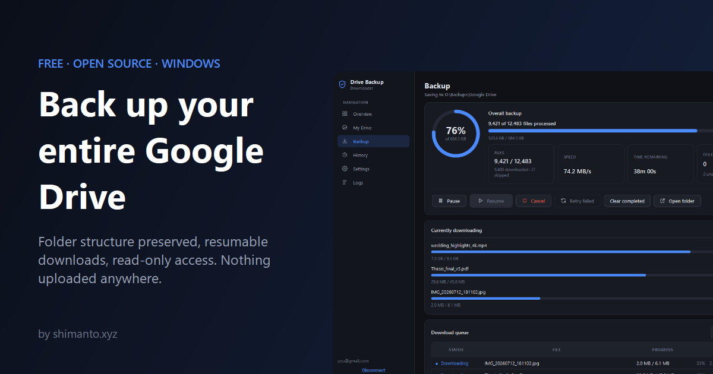
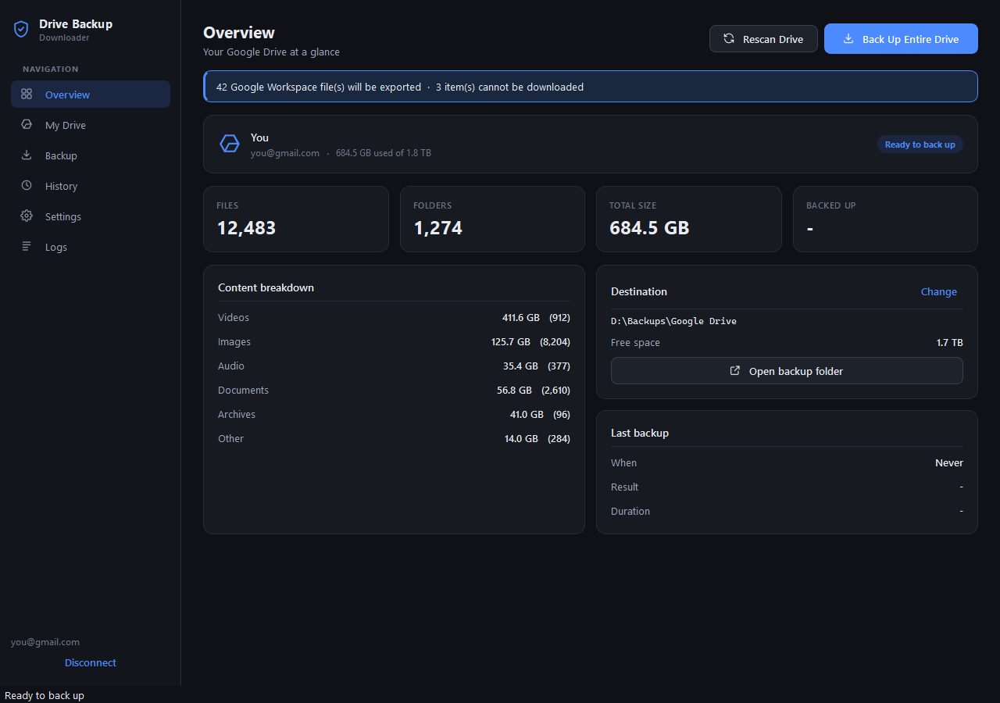
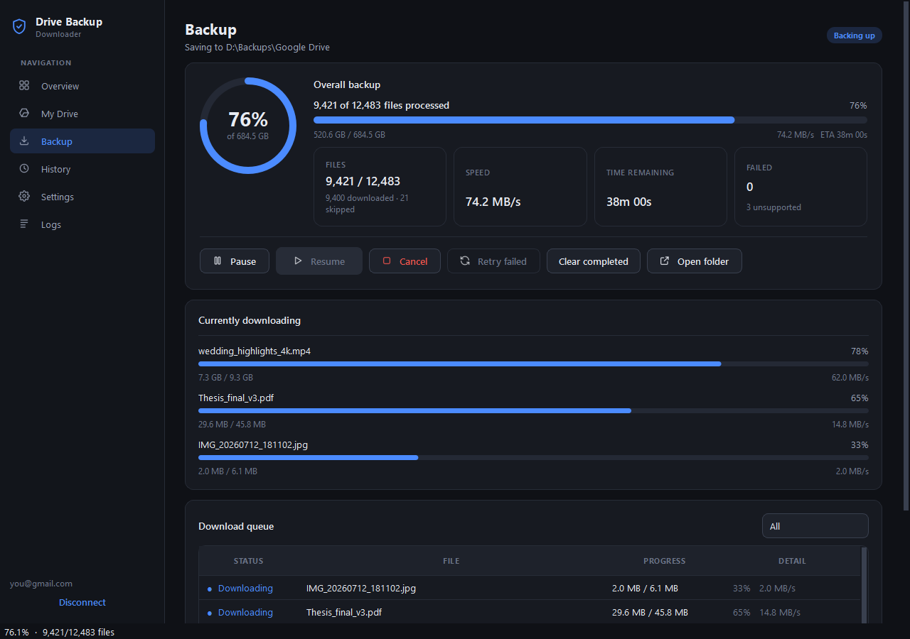
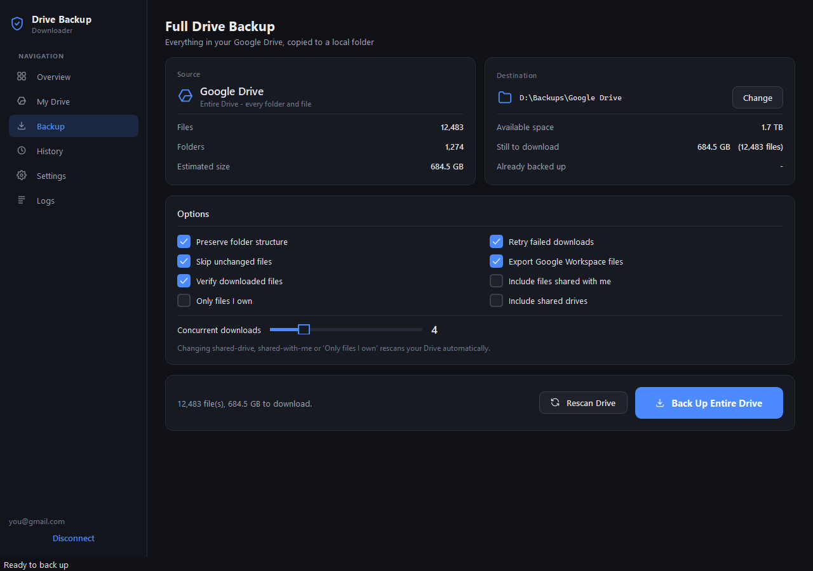
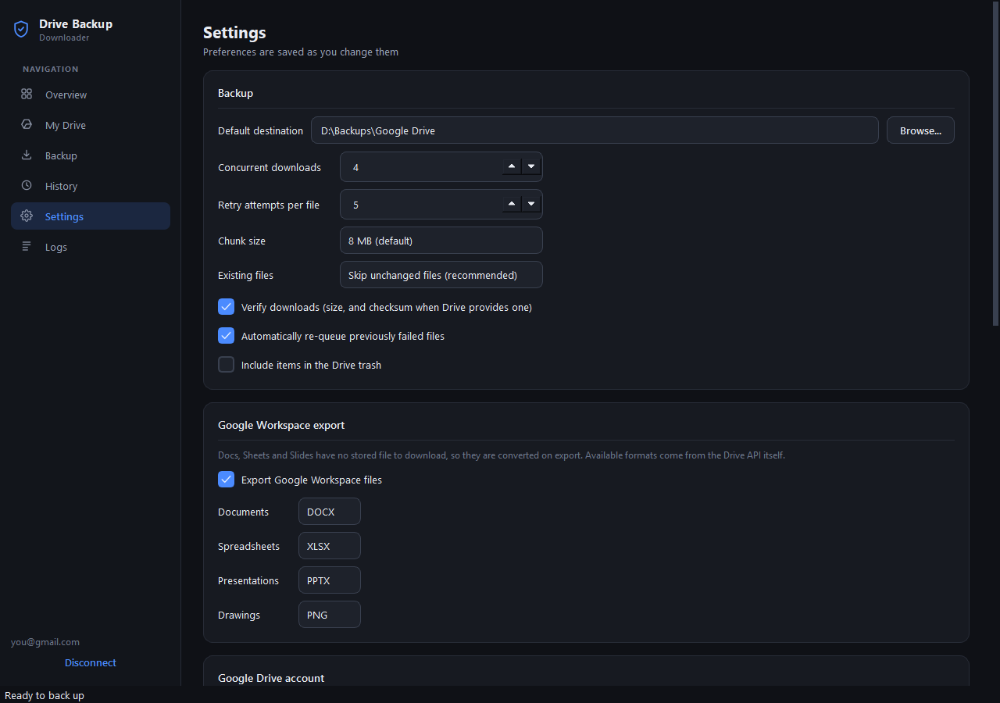
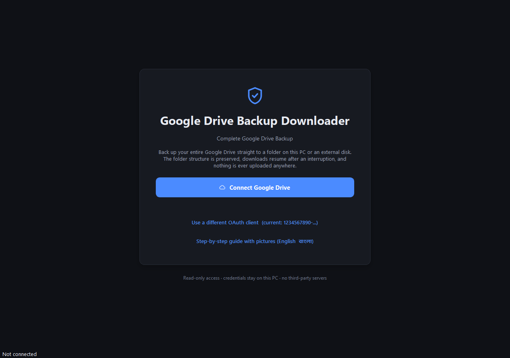

<div align="center">



# Google Drive Backup Downloader

**Download your entire Google Drive to your PC or an external hard drive in one click, with folders intact, resumable transfers and incremental re-runs.**

[](https://github.com/shimentosh/google-drive-backup-downloader/releases/latest)
[](https://github.com/shimentosh/google-drive-backup-downloader/releases)
[](https://github.com/shimentosh/google-drive-backup-downloader/actions/workflows/ci.yml)
[](LICENSE)
[](https://github.com/shimentosh/google-drive-backup-downloader/releases/latest)
[](https://www.python.org/)

### [**Download for Windows**](https://github.com/shimentosh/google-drive-backup-downloader/releases/latest) &nbsp;·&nbsp; [Website](https://shimentosh.github.io/google-drive-backup-downloader/) &nbsp;·&nbsp; [Setup guide](#google-cloud-setup)

</div>

---

## Why this exists

**Google Takeout** is the usual way to download all of your Google Drive, and it isn't built
for regular backups. It packs your files into 2 GB or 50 GB zip archives that you have to
download one at a time and extract by hand. Every export starts over from scratch, and if a
link expires or your connection drops you lose your place.

**Google Drive Backup Downloader** is a free, open-source **Google Takeout alternative** for
Windows. It **downloads your entire Google Drive** straight into an ordinary folder on your PC,
an **external hard drive**, or a NAS, and it **keeps your folder structure exactly as it is in
Drive**. There are no zips to split or extract. If a download is interrupted it **resumes**
from the byte where it stopped, and when you run it again next week it only fetches files that
are new or changed.

Nothing is uploaded anywhere. Data flows **Google → Google Drive API → your PC**, and
that is the only path it takes.

---

## Screenshots

<div align="center">

<picture>
  <source media="(prefers-color-scheme: dark)" srcset="docs/assets/screenshots/overview.png">
  <source media="(prefers-color-scheme: light)" srcset="docs/assets/screenshots/overview-light.png">
  
</picture>

</div>

<table>
  <tr>
    <td width="50%" align="center">
      <picture>
        <source media="(prefers-color-scheme: dark)" srcset="docs/assets/screenshots/backup.png">
        <source media="(prefers-color-scheme: light)" srcset="docs/assets/screenshots/backup-light.png">
        
      </picture>
      <br><sub><b>Backup:</b> live progress, speed, ETA and the per-file queue</sub>
    </td>
    <td width="50%" align="center">
      <picture>
        <source media="(prefers-color-scheme: dark)" srcset="docs/assets/screenshots/setup.png">
        <source media="(prefers-color-scheme: light)" srcset="docs/assets/screenshots/setup-light.png">
        
      </picture>
      <br><sub><b>Setup:</b> file count, total size and a free-space check before you start</sub>
    </td>
  </tr>
  <tr>
    <td width="50%" align="center">
      <picture>
        <source media="(prefers-color-scheme: dark)" srcset="docs/assets/screenshots/settings.png">
        <source media="(prefers-color-scheme: light)" srcset="docs/assets/screenshots/settings-light.png">
        
      </picture>
      <br><sub><b>Settings:</b> concurrency, export formats, theme and keep-awake</sub>
    </td>
    <td width="50%" align="center">
      <picture>
        <source media="(prefers-color-scheme: dark)" srcset="docs/assets/screenshots/welcome.png">
        <source media="(prefers-color-scheme: light)" srcset="docs/assets/screenshots/welcome-light.png">
        
      </picture>
      <br><sub><b>Welcome:</b> connect your Google account in your browser</sub>
    </td>
  </tr>
</table>

<sub>Screenshots switch between dark and light to match your GitHub theme. To regenerate them, run <code>python packaging/screenshots.py</code>.</sub>

---

## Features

- **Backs up the whole Drive in one action.** You don't pick folders one at a time. The
  main button is *Back Up Entire Drive*.
- **Mirrors your folder hierarchy exactly.** `Videos/YouTube/2026/video3.mp4` in Drive
  becomes `D:\Backup\Videos\YouTube\2026\video3.mp4` locally. Files are never flattened.
- **Streams large files.** A 40 GB video uses the same memory as a 40 KB one, because bytes
  go straight from the HTTP response to disk in chunks.
- **Resumes interrupted downloads.** If the network drops, the app crashes or you pause, a
  partially downloaded file continues from the byte where it stopped, using HTTP `Range`
  requests.
- **Incremental backups.** Point it at the same destination next week and it only fetches
  new and modified files.
- **Verifies every file.** It always checks the size, and also checks the MD5 checksum that
  Drive publishes for stored files. A file is only renamed from `name.gdbd.part` to `name`
  after it passes verification.
- **Exports Google Workspace files.** Docs → DOCX/PDF, Sheets → XLSX/CSV, Slides →
  PPTX/PDF, Drawings → PNG/SVG/PDF, Vids → MP4.
- **Supports shared drives and files shared with you.** Both are optional.
- **Never deletes your local files.** Not when a file disappears from Drive, not on
  cancel and not on disconnect. Removing files is always your decision.
- **Keeps going when one file fails.** Each failure is recorded with a readable reason and
  the run carries on. You can retry the failed files afterwards.
- **Read-only and private.** It uses the `drive.readonly` scope, sends no telemetry and talks
  to no server except Google's.
- **Built for long runs.** Keeps the PC awake while downloading, shows a live percentage in
  the taskbar, and notifies you when the backup finishes. Dark and light themes included.

---

## Quick start (3 steps)

1. **Download the app.** Get the latest release from the
   [**Releases page**](https://github.com/shimentosh/google-drive-backup-downloader/releases/latest):
   - `GoogleDriveBackupDownloader-portable.exe` is a single file. Just double-click it.
   - `GoogleDriveBackupDownloader-windows.zip` starts faster. Unzip it and run
     `GoogleDriveBackupDownloader.exe`.

   > The executable isn't code-signed, so Windows SmartScreen may show *"Windows protected
   > your PC"*. Click **More info → Run anyway**. You can also build it yourself from source
   > (see [Building a standalone .exe](#building-a-standalone-exe)).

2. **Do the one-time Google setup (about 5 minutes).** Create your own free OAuth client and
   download `credentials.json`. The [Google Cloud setup](#google-cloud-setup) section below
   walks you through it.

3. **Back up.** Click **Connect Google Drive**, choose a destination folder (for example an
   external hard drive) and click **Back Up Entire Drive**.

That's it. Run it again whenever you like, and only the changes are downloaded.

---

## New in 1.2.0

- **Guided first-run setup.** The welcome screen walks you through Google's one-time setup
  in 5 numbered steps, each with an **Open** button that jumps to the exact Google Cloud page.
- **[Illustrated setup guide](https://shimentosh.github.io/google-drive-backup-downloader/setup.html)**
  in English and বাংলা, with a fix for every common Google error.
- **Plain-language errors.** "Access blocked", `redirect_uri_mismatch`, a disabled Drive API
  and the weekly sign-out are each explained with the exact fix.

### 1.1.0

- **Keeps your PC awake** while a backup is downloading, so Windows sleep no longer
  interrupts long runs (Settings → *While a backup runs*). A paused backup lets the PC sleep
  normally.
- **Desktop notification** and a taskbar flash when a backup finishes while the window is in
  the background.
- **Live progress on the taskbar.** The window title shows the percentage backed up.
- **About** section in Settings with the version, an update check, and links to the website,
  source code and issue tracker.
- **Restart to apply** button after you change the theme. Setup help now links straight to
  the online guide and the Google Cloud Console.
- **Fixes:** the *Backup* page now scrolls on short windows and shows the destination
  instead of "Idle". Settings that would trigger a rescan or a reconnect are now locked
  while a backup is running. Checkbox ticks are clearer, and warnings stay on screen longer.

See [CHANGELOG.md](CHANGELOG.md) for the full list.

---

## FAQ

<details>
<summary><b>Is it safe? Can it delete or change my Google Drive files?</b></summary>

No. The app only requests the `drive.readonly` permission, so Google itself prevents it from
modifying, moving or deleting anything in your Drive. You sign in on Google's own page in your
browser, and the app never sees your password. It also never deletes files from your local
backup folder.
</details>

<details>
<summary><b>Is it free?</b></summary>

Yes. It's free and open source under the MIT license. The Google Cloud project it needs is
also free, because personal Drive API usage has no cost.
</details>

<details>
<summary><b>Does it back up Google Docs, Sheets and Slides?</b></summary>

Yes. Google Workspace files are exported to standard formats: Docs to DOCX or PDF, Sheets to
XLSX or CSV, Slides to PPTX or PDF, Drawings to PNG, SVG or PDF, and Vids to MP4. Google Forms,
Sites and My Maps have no export format in the Drive API, so the app lists them with that
reason instead of silently skipping them.
</details>

<details>
<summary><b>How is it different from Google Takeout?</b></summary>

Takeout produces 2 GB or 50 GB zip archives that you download and extract by hand, and every
export starts over from nothing. This app downloads straight into a normal folder tree that
matches your Drive. It resumes interrupted files, verifies checksums, and on later runs only
downloads what is new or changed, which makes it practical for regular backups.
</details>

<details>
<summary><b>Can I back up Google Drive to an external hard drive or a NAS?</b></summary>

Yes. You can choose any local disk, external HDD or SSD, USB drive or network path as the
destination. Before starting, the app checks that there is enough free space. If the drive is
disconnected mid-backup, the run pauses safely and you can resume once it is reconnected.
</details>

<details>
<summary><b>What happens if my internet connection drops?</b></summary>

Temporary errors are retried automatically with exponential backoff. Partially downloaded files
continue from the exact byte where they stopped. If the app is closed, or the PC restarts,
relaunch it and click **Resume backup**.
</details>

<details>
<summary><b>Does it work on Mac or Linux?</b></summary>

The Python code runs on macOS and Linux (`python app.py`), but ready-made builds and testing
focus on Windows 10 and 11. Windows-only features, such as Credential Manager token storage
and keeping the PC awake, are simply skipped on other systems.
</details>

<details>
<summary><b>Why do I need my own Google Cloud credentials?</b></summary>

The app talks to Google directly from your PC, with no server in the middle. Using your own
OAuth client means your access is tied to a project only you control, the API quota is all
yours, and nobody else's app is involved. Setup takes about five minutes:
[Google Cloud setup](#google-cloud-setup).
</details>

---

## Contents

- [Requirements](#requirements)
- [Google Cloud setup](#google-cloud-setup)
- [Install and run from source](#install-and-run-from-source)
- [Using the app](#using-the-app)
- [Where your data lives](#where-your-data-lives)
- [Running the tests](#running-the-tests)
- [Building a standalone .exe](#building-a-standalone-exe)
- [How it works](#how-it-works)
- [Google Drive API limitations](#google-drive-api-limitations)
- [Troubleshooting](#troubleshooting)
- [Security and privacy](#security-and-privacy)
- [Project structure](#project-structure)
- [Contributing](#contributing)

---

## Requirements

| | |
|---|---|
| OS | Windows 10 / 11 (the code also runs on macOS and Linux) |
| Python | **3.12 or newer** (only if you run from source) |
| Disk | Enough free space for your Drive, plus about 1 GB of headroom |
| Account | A Google account and a free Google Cloud project |

---

## Google Cloud setup

> 📖 **Illustrated step-by-step guide (English & বাংলা): https://shimentosh.github.io/google-drive-backup-downloader/setup.html**

The app talks to Google directly with **your own** key, so no third-party server ever touches
your files. It gets read-only access (it cannot delete or change anything), and you never type
your Google password into the app. This is a one-time setup: about five minutes, free, no
credit card.

```
Create a Google Cloud project
        ↓
Turn on the Google Drive API
        ↓
Google Auth platform → Branding (consent screen)
        ↓
Google Auth platform → Audience → add yourself as a test user
        ↓
Google Auth platform → Clients → Create client (type: Desktop app) → Download JSON
        ↓
Give the JSON file to the app → Connect Google Drive
```

### Step by step

1. **Create a Google Cloud project**
   Open <https://console.cloud.google.com/projectcreate> and sign in with the same Gmail you
   want to back up. Name the project anything (for example `drive-backup`) → **Create**. Wait
   about 10 seconds and make sure the new project is selected in the project picker in the
   top bar.

2. **Turn on the Google Drive API**
   Open <https://console.cloud.google.com/flows/enableapi?apiid=drive.googleapis.com>, confirm
   the project → **Next** / **Enable**. (If the page shows an **Enable** button, click it.)

3. **Set up the Google Auth platform (consent screen)**
   Open <https://console.cloud.google.com/auth/branding>. If it says *"Google Auth platform not
   configured yet"*, click **Get Started**.
   - **App Information**: App name (for example `My Drive Backup`), User support email (your
     Gmail) → **Next**
   - **Audience**: choose **External** → **Next**
   - **Contact Information**: your email → **Next**
   - **Finish**: tick *"I agree to the Google API Services: User Data Policy"* → **Continue** →
     **Create**

4. **Add yourself as a test user**
   Open <https://console.cloud.google.com/auth/audience> → under **Test users** click
   **Add users** → type your Gmail → **Save**.
   This is the #1 mistake. Without it, Google shows *"Access blocked: … has not completed the
   Google verification process"* / *Error 403: access_denied*.

5. **Create the Desktop app key**
   Open <https://console.cloud.google.com/auth/clients> → **Create Client** → Application type:
   **Desktop app** (*not* Web application, which causes *Error 400: redirect_uri_mismatch*) →
   name it anything → **Create**.

   > ⚠️ **Click Download JSON right away.** A dialog shows your Client ID and Client secret.
   > Google shows the secret only once; if you close the dialog without downloading, just
   > create a new client. Keep the file private: never share or upload it.

6. **Give the file to the app**
   Open the app. On the welcome screen click **Choose downloaded JSON file…**, drag the `.json`
   file onto the window, or paste the Client ID and Client secret. (The in-app wizard walks you
   through the same steps.)

   Advanced alternatives: the app also looks for the file in these locations (in this order),
   or you can pick it in **Settings → Advanced → OAuth client file**:

   ```
   the path in the GDBD_CREDENTIALS_FILE environment variable
   %LOCALAPPDATA%\GDriveBackup\credentials.json
   the folder you run the app from
   the folder containing app.py (or the .exe)
   ```

   Or set two environment variables (see `.env.example`):

   ```
   GDBD_CLIENT_ID=...apps.googleusercontent.com
   GDBD_CLIENT_SECRET=GOCSPX-...
   ```

7. **Connect your Google account**
   Click **Connect Google Drive**. Your browser opens; choose your account. Google shows
   *"Google hasn't verified this app"*. This is expected, because **you** are the developer of
   your own private key: click **Continue** (if you only see **Advanced**, click **Advanced →
   Go to &lt;app name&gt; (unsafe)**). On the permission screen, tick *"See and download all
   your Google Drive files"* (wording may vary slightly) → **Continue**. When the browser says
   you can close the tab, the app shows your account. Choose a destination folder and click
   **Back Up Entire Drive**.

### Optional but recommended: stop the weekly re-login

While the app is in *Testing* mode, Google signs you out every 7 days (refresh tokens for
Testing apps expire after a week). To avoid this, open
<https://console.cloud.google.com/auth/audience> → **Publishing status** → **Publish app** →
**Confirm**. Personal use (under 100 users) does not need Google verification; you will still
click through the "unverified app" screen once.

---

## Install and run from source

Most people should use the [Windows download](https://github.com/shimentosh/google-drive-backup-downloader/releases/latest).
To run from source:

```powershell
# 1. Clone the repository
git clone https://github.com/shimentosh/google-drive-backup-downloader.git
cd google-drive-backup-downloader
py -3.12 -m venv .venv
.venv\Scripts\activate

# 2. Install dependencies
pip install -r requirements.txt

# 3. Run
python app.py
```

Command-line options:

```
python app.py --debug              verbose logging
python app.py --data-dir D:\gdbd   keep database, settings and logs elsewhere
python app.py --version
```

The database is created automatically the first time you launch the app. There is no
separate initialisation step.

---

## Using the app

1. **Connect Google Drive.** Your browser opens Google's consent screen. Approve it, and the
   app receives credentials on a local loopback port.
2. **Choose a destination folder.** Any local disk, external HDD or SSD, or network path works.
3. **Let the scan run.** The Drive is scanned automatically, and you see folders and files
   as they are discovered.
4. **Review.** The *Backup* page shows the file count, folder count, total size, how much is
   still to download, and the free space on the target volume.
5. **Click Back Up Entire Drive.**
6. **Watch progress.** You see the current files with per-file bars, overall byte-based
   progress, speed, ETA, and a live queue with the status of each file.
7. **Pause, Resume or Cancel** at any time. Progress is saved either way.

If you run the backup again later against the same folder, it only transfers what changed.

### If the app closed mid-backup

Relaunch it. Interrupted items are moved back to a resumable state, the *Overview* page
offers **Resume backup**, and partially downloaded files continue from where they stopped.

---

## Where your data lives

| What | Where |
|---|---|
| Database | `%LOCALAPPDATA%\GDriveBackup\gdbd.sqlite3` |
| Settings | `%LOCALAPPDATA%\GDriveBackup\settings.json` |
| Logs | `%LOCALAPPDATA%\GDriveBackup\logs\app.log` and `backup_YYYY-MM-DD.log` |
| OAuth token | Windows Credential Manager, or a restricted `token.json` as fallback |
| Your files | The destination folder you chose, and nowhere else |

All of these are listed, with **Open** buttons, under **Settings → Advanced**.

---

## Running the tests

```powershell
.venv\Scripts\activate
pip install -r requirements-dev.txt
pytest
```

The 300+ tests cover filename sanitization, path construction, the database and its
incremental-backup behaviour, Drive scanning, the download engine (streaming, resume,
retry, verification, pause, cancel and concurrency), end-to-end backup flows, and the UI.
They run on every push and pull request through GitHub Actions
([`.github/workflows/ci.yml`](.github/workflows/ci.yml)).

**No Google credentials are needed.** The Drive API is replaced by an in-process fake that
serves bytes, honours `Range` headers, and can be scripted to return 403/429/503 errors or
to drop a connection mid-transfer.

```powershell
pytest tests/test_download_manager.py -v   # one module
pytest -k resume                            # one topic
```

---

## Building a standalone .exe

```powershell
.venv\Scripts\activate
pip install -r requirements-dev.txt

.\packaging\build_exe.ps1              # folder build (starts fastest)
.\packaging\build_exe.ps1 -OneFile     # single .exe (easiest to copy)
.\packaging\build_exe.ps1 -SkipTests   # skip the pre-build test run
```

Output lands in `dist\GoogleDriveBackupDownloader\`: a launcher of about 6.5 MB plus its Qt
runtime, about 233 MB in total. Run it by double-clicking
`GoogleDriveBackupDownloader.exe`. It accepts the same `--data-dir` and `--debug` flags
as `app.py`.

If PowerShell reports a `NativeCommandError` while PyInstaller is running, PowerShell 5.1 is
treating PyInstaller's progress output on stderr as a failure. Check whether `dist\` was
produced, or invoke PyInstaller directly:

```powershell
python -m PyInstaller --noconfirm --clean packaging\drive_backup.spec
```

The application icon in `assets\app.ico` is generated from the app's own shield glyph
and is committed, so a build needs no design tooling. To regenerate it, run:

```powershell
python packaging\make_icon.py
```

The README and website screenshots in `docs/assets/screenshots/` are generated from the real
UI, in both dark and light themes. To regenerate them, run:

```powershell
python packaging\screenshots.py
```

`credentials.json` is deliberately **not** bundled, so the executable can be shared
without leaking your OAuth client. Place it next to the `.exe` or in
`%LOCALAPPDATA%\GDriveBackup\` before the first run.

### Releases

Releases are automated. Pushing a tag that matches `v*` (for example `v1.2.0`) triggers
[`.github/workflows/release.yml`](.github/workflows/release.yml), which runs the tests, builds
both variants on Windows and publishes a GitHub Release with two files:

| File | Description |
|---|---|
| `GoogleDriveBackupDownloader-portable.exe` | A single file. Just double-click it. |
| `GoogleDriveBackupDownloader-windows.zip` | Folder build that starts faster. Unzip it, then run `GoogleDriveBackupDownloader.exe`. |

```powershell
git tag v1.2.0
git push origin v1.2.0
```

---

## How it works

<details>
<summary><b>Scanning, downloading, resume, concurrency and threading</b> (click to expand)</summary>

### Scanning

A Drive is listed in **one flat paginated pass** (`files.list` with `nextPageToken`
followed to the end) rather than folder by folder, which needs far fewer API calls. Folders
are held in memory, while files stream into a temporary SQLite staging table, so a Drive with
a million files never has to fit in RAM. The hierarchy is then rebuilt locally from each
item's `parents`, and every item is assigned a sanitized, de-duplicated relative path.

Because the scan order is deterministic, the same Drive always produces the same local
layout. That is what makes repeat backups line up with the files already on disk.

### Downloading

There are three strategies. The scan picks one for each item and records it:

| Strategy | Used for | Resumable |
|---|---|---|
| `BinaryMediaDownloader` | anything with stored bytes (`files.get?alt=media`) | yes, via `Range` |
| `WorkspaceExportDownloader` | Docs, Sheets, Slides, Drawings, Vids (`files.export`) | no, because content is generated on demand |
| `SpecialFileDownloader` | Forms, Sites, My Maps, shortcuts | n/a (reported with a reason) |

Supporting a new Google file type later means adding one mapping, not touching the engine.

### Resume

Bytes always land in `<name>.gdbd.part`. The **size of that file on disk**, not the number
in the database, decides how much has arrived, because it is the only value that survives a
power cut. On resume the app sends `Range: bytes=N-`. If the server answers `200` instead of
`206`, the app restarts the file cleanly rather than splicing two halves together. The final
rename only happens after verification passes.

### Concurrency and rate limits

A fixed pool of workers (1–16, default 4) shares a token-bucket limiter that keeps the app
inside Drive's per-user quota. Retries use exponential backoff with jitter (2s, 4s, 8s,
16s… capped at 64s) for HTTP 429, 5xx and transport failures. Permanent errors (404,
permission denied, unsupported export) are not retried.

### Threading

The Qt main thread only draws the UI. Scanning, authentication and downloading run on
worker threads and report back through Qt signals. Progress is aggregated and emitted a
few times per second rather than for every chunk, and the database is written on a timer
instead of on every byte.

</details>

---

## Google Drive API limitations

These are real constraints of the Drive API, not gaps in this app. The app handles each one
explicitly.

| Limitation | What the app does |
|---|---|
| **Google Forms, Sites and My Maps have no export format.** | Marked `UNSUPPORTED` with the specific reason. Never retried. |
| **`files.export` refuses documents over 10 MB.** | Falls back to the item's own `exportLinks` URL, which Google serves without that cap. If that also fails, the file is reported with a suggestion to try PDF. |
| **Exports cannot be resumed.** | Generated content has no stable byte range, so exports restart. That is cheap because they are small. |
| **Workspace files report no size.** | They count as 0 towards the estimated total, so overall byte progress is based on files whose size Drive actually knows. Their file counts are still exact. |
| **Only stored files have an MD5.** | Checksum verification applies to binary files. Exports are verified by size and by checking they are not empty. |
| **Shortcuts point elsewhere.** | Skipped, because the target is backed up at its own location. Recorded with that reason rather than silently dropped. |
| **A file's owner can disable downloading.** | Detected from `capabilities.canDownload` during the scan and reported before any download is attempted. |
| **Files flagged as abusive need an explicit acknowledgement.** | Retried once with `acknowledgeAbuse=true`, since you asked for a complete backup. |
| **Files can live outside My Drive** (shared with you, or orphaned). | Placed under `Shared with me\` or `_Unfiled\` so nothing is lost or misfiled. Shared-with-me is off by default. |
| **Drive allows duplicate names in one folder.** | Files are identified by `file_id`, never by name. Duplicates become `report.pdf`, `report (1).pdf`, deterministically. |
| **Drive allows names Windows forbids.** | Sanitized deterministically (`Project: Final / Version?.mp4` → `Project - Final - Version_.mp4`), and every rename is logged to the database. |
| **API quotas.** | Token-bucket rate limiting plus exponential backoff on 429. |

### Shared drives

The Drive client, scanner and path builder all handle shared drives (`corpora=drive`,
`includeItemsFromAllDrives`), which appear under `Shared drives\<name>\`. The option is
**off by default** and can be turned on from the *Backup* page. Accounts with no shared
drives are unaffected: a failed `drives.list` is logged and ignored instead of breaking
the My Drive backup.

---

## Troubleshooting

**"No Google OAuth client was found"**
`credentials.json` isn't in any of the searched locations. The error message lists every
path that was checked. Use **Settings → Advanced → OAuth client file** to point at it
directly.

**"…is not an OAuth client file" / "contains a Web-application OAuth client"**
You downloaded the wrong credential type. Create a new OAuth client with application type
**Desktop app**.

**"Access was denied on the Google consent screen" / "Access blocked" / Error 403: access_denied**
Your app is in *Testing* mode and your account isn't listed. Add it under
**Google Auth platform → Audience → Test users**
(<https://console.cloud.google.com/auth/audience>), or publish the app (see
[stop the weekly re-login](#optional-but-recommended-stop-the-weekly-re-login)).

**"Google hasn't verified this app"**
This is expected for a personal OAuth client, because you are its developer. Click
**Continue** (or **Advanced → Go to &lt;app name&gt; (unsafe)** if that is all you see).

**Error 400: redirect_uri_mismatch**
The OAuth client is the wrong type. Create a new client with application type **Desktop app**.

**"Google Drive API has not been used in project … or it is disabled"**
Turn on the Drive API in the *same* project as your OAuth client (step 2), then wait a few
minutes and try again.

**Lost the client secret**
Google shows it only once. Create a new client under **Google Auth platform → Clients** and
click **Download JSON** right away.

**Signed out / asked to sign in again after 7 days**
Google expires sign-ins for *Testing* apps after 7 days. Publish the app:
**Google Auth platform → Audience → Publishing status → Publish app**. See
[stop the weekly re-login](#optional-but-recommended-stop-the-weekly-re-login).

**"Windows protected your PC" (SmartScreen)**
The executable isn't code-signed. Click **More info → Run anyway**, or build it from source.

**"Google rejected the saved authorisation"**
The grant was revoked or expired. Go to **Settings → Reconnect**.

**"Not enough disk space"**
The pre-flight check compares what is left to download against the free space plus a 1 GB
margin. Free up space or choose another destination. If a volume fills up mid-backup, the
run pauses safely instead of corrupting files.

**"Destination unavailable"**
An external or network drive was disconnected. Reconnect it and resume. Completed files and
partial files are still there.

**A file failed**
Open **My Drive**, filter by **Failed**, and hover over a row to see the reason. **Retry
failed** on the *Backup* page puts them all back in the queue.

**Backup seems slow**
Raise **Concurrent downloads** (in Settings, up to 16) and the **chunk size**. Beyond that,
the limit is your connection or Google's per-user quota.

**Backup stopped when the PC went to sleep**
Since 1.1.0 the app keeps Windows awake while a backup is downloading. Check that
**Settings → While a backup runs** is enabled.

**Long paths on Windows**
These are handled automatically with the `\\?\` extended-length prefix. Very long Drive
names are shortened deterministically with a short hash so they stay unique.

---

## Security and privacy

- **Read-only.** The app requests `https://www.googleapis.com/auth/drive.readonly` and
  nothing more, so it cannot modify or delete anything in your Drive. Neither narrower scope
  is enough for a backup: `drive.file` cannot see files the app didn't create, and
  `drive.metadata.readonly` cannot download content.
- **Your password is never seen or asked for.** Authentication happens entirely in your
  browser, on Google's own domain.
- **No secrets in the repository.** `credentials.json`, `token.json` and `.env` are
  git-ignored, and nothing is hard-coded.
- **Tokens are stored in the Windows Credential Manager** when it is available. Otherwise
  they go in a file that `icacls` restricts to your user account.
- **Tokens are never logged.** A redaction filter sits on every log handler and masks
  anything shaped like an access token, refresh token, bearer header or client secret,
  even if a third-party library tries to log it.
- **No third-party servers, no telemetry, no analytics.** The only host the app contacts is
  Google's own API.
- **Disconnecting revokes the token** with Google and clears the local copy. Your
  downloaded files are left untouched.

To report a vulnerability, see [SECURITY.md](SECURITY.md).

---

## Project structure

<details>
<summary><b>Source tree</b> (click to expand)</summary>

```
google-drive-backup-downloader/
│
├── app.py                      entry point
├── requirements.txt            runtime dependencies
├── requirements-dev.txt        + test and packaging tools
├── credentials.json.example    OAuth client template
├── .env.example                optional environment configuration
├── pytest.ini
│
├── gdbd/
│   ├── constants.py            scopes, chunk sizes, retry policy, MIME constants
│   │
│   ├── config/settings.py      app paths + persisted user settings
│   │
│   ├── auth/
│   │   ├── google_auth.py      OAuth flow, refresh, revoke
│   │   └── token_manager.py    Credential Manager / restricted-file storage
│   │
│   ├── drive/
│   │   ├── client.py           Drive API v3 wrapper (metadata + streaming)
│   │   ├── pagination.py       nextPageToken loop, retry, rate limiter
│   │   ├── models.py           DriveFile, MIME classification
│   │   ├── exporters.py        which strategy each item needs
│   │   └── scanner.py          full-Drive scan and hierarchy reconstruction
│   │
│   ├── downloader/
│   │   ├── base.py             strategy interface, pause/cancel control
│   │   ├── binary.py           streaming media download with Range resume
│   │   ├── workspace.py        Workspace export, with exportLinks fallback
│   │   ├── special.py          shortcuts and non-downloadable types
│   │   ├── strategies.py       strategy registry
│   │   ├── resume.py           .part file bookkeeping
│   │   ├── retry.py            error classification and retry policy
│   │   ├── verifier.py         size and checksum verification
│   │   ├── worker.py           one item, end to end
│   │   └── manager.py          worker pool, progress, pause/resume/cancel
│   │
│   ├── database/
│   │   ├── db.py               thread-safe SQLite access
│   │   ├── schema.py           DDL, item and session statuses
│   │   ├── models.py           typed row objects
│   │   └── repositories.py     all SQL
│   │
│   ├── filesystem/
│   │   ├── sanitizer.py        Windows-safe names, dedupe
│   │   ├── paths.py            path allocation, long-path support
│   │   └── storage.py          disk space, atomic placement
│   │
│   ├── services/
│   │   ├── event_bus.py        application states
│   │   ├── scan_service.py     scan orchestration
│   │   ├── backup_service.py   pre-flight, session bookkeeping, execution
│   │   └── controller.py       Qt-facing controller
│   │
│   ├── ui/
│   │   ├── theme.py            dark/light palette and stylesheet
│   │   ├── icons.py            inline SVG icon set
│   │   ├── main_window.py      shell and signal wiring
│   │   ├── welcome.py          first-run / connect
│   │   ├── dashboard.py        overview
│   │   ├── drive_browser.py    search and filter
│   │   ├── setup.py            backup setup and pre-flight
│   │   ├── backup.py           live progress and queue
│   │   ├── history.py          past runs
│   │   ├── settings_page.py    preferences
│   │   ├── logs.py             log viewer
│   │   └── widgets/            cards, progress bars, queue table
│   │
│   └── utils/                  logging (with redaction), formatting, time, backoff
│
├── assets/app.ico              generated application icon
├── docs/                       website (GitHub Pages), social card, screenshots
├── tests/                      300+ tests, no credentials required
├── packaging/                  PyInstaller spec, build script, icon and screenshot generators
└── .github/workflows/          ci.yml (tests), release.yml (Windows builds on v* tags)
```

</details>

---

## Contributing

Bug reports, ideas and pull requests are welcome. Read [CONTRIBUTING.md](CONTRIBUTING.md) to
get started, and please make sure `pytest` passes before you open a pull request. For security
issues, follow [SECURITY.md](SECURITY.md) rather than opening a public issue.

## License

[MIT](LICENSE) © Shimanto.

You are responsible for your own Google Cloud project and for complying with Google's API
Terms of Service. This project is not affiliated with or endorsed by Google. Google Drive is
a trademark of Google LLC.

---

<div align="center">

Made with care by [Shimanto](https://shimanto.xyz)

If this app saved your files (or your weekend), please **[give it a star on GitHub](https://github.com/shimentosh/google-drive-backup-downloader)**. It helps other people find it.

</div>
